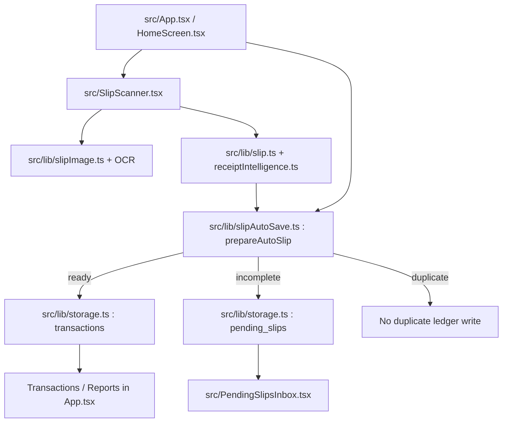
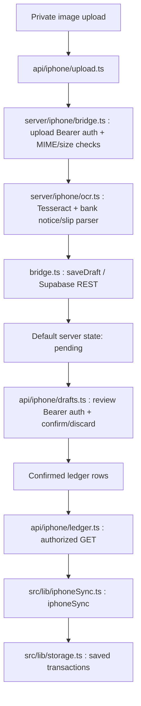

# Money Tracker — source-grounded architecture & QA boundaries

Reviewed against `main` on 2026-10-21 (base SHA `3d5b0ca09f6f7b1343c1453503ce0d350afeea2c`). **This is a static code-path inspection, not a runtime, real-device, production, or auth E2E result.** Refresh after PR #63 and PR #66 are resolved.

## Confirmed primary browser route

`src/SlipScanner.tsx` imports recognition/image recovery, parse, review and batch helpers. `src/App.tsx` owns scanner callbacks and imports `prepareAutoSlip`, transaction storage and pending helpers. The verified auto-save decision returns `ready`, `incomplete` or `duplicate`; the `incomplete` branch does **not** count toward confirmed financial transactions. `src/lib/storage.ts` currently opens local IndexedDB `ngoentoday-db` **version 2**, with stores `transactions`, `settings` and `pending_slips` (the older `docs/ARCHITECTURE.md` schema section still says version 1; reconcile it when updating core docs).

## Confirmed optional API sync route

- `api/iphone/upload.ts` checks upload token and supported file type/size, then saves a server draft. Its success response on a newly written draft is **pending**, not a verified Saved transaction.
- `api/iphone/drafts.ts` uses separate review-token auth and allowed-origin checks to confirm/discard a pending draft.
- `api/iphone/ledger.ts` returns confirmed entries; `src/lib/iphoneSync.ts` validates and imports them to local IndexedDB. The review token is stored in client localStorage; assess its exposure, logout/clear path and deployment boundary during P1 review.
- `server/iphone/bridge.ts` uses configured upload and review tokens, constant-time comparison, owner-key scoping and Supabase REST service credentials on the server.
- `api/iphone/health.ts` is a liveness probe and not evidence of end-to-end OCR or ledger reconciliation.

## P0 identified divergence (must not misstate as fixed on main)

At this inspected `main` revision, `server/iphone/ocr.ts` sets `slip=bankLike?null:parseSlipText(raw)`: bank-like image OCR bypasses general slip parsing. Open [PR #63](https://github.com/kreecrypto/Money-Tracker/pull/63) reports a candidate fix on its own branch. **Do not assume the PR fix is deployed or that merged #65's private golden baseline covers this API path.** Track and verify on physical iPhone and isolated staging under [#67](https://github.com/kreecrypto/Money-Tracker/issues/67).

## Ownership, safety and QA pointers

| Boundary | Invariant | Source | Focused checks |
|---|---|---|---|
| Amount/direction | Positive safe integer satang; don't guess | `src/lib/slipAutoSave.ts`, `src/lib/finance.ts` | `tests/slipAutoSave.test.ts`, `tests/finance.test.ts` |
| OCR accuracy | Pixel recognition vs text parsing are different gates | `src/SlipScanner.tsx`, `server/iphone/ocr.ts` | `tests/ocrRealImageGolden.test.ts` (private opt-in); browser/iPhone UAT |
| Duplicate/Pending | No duplicate saved totals, uncertain data isolated | `src/lib/slipAutoSave.ts`, `src/lib/storage.ts` | `tests/slipBatch.test.ts`, `tests/pendingSlips.test.ts` |
| API auth | Two Bearer token scopes; no client service key | `server/iphone/bridge.ts`, `api/iphone/*.ts` | `tests/iphoneShortcuts.test.ts`, `tests/iphoneStorageHealth.test.ts` |
| Sync and data persistence | Confirmed remote entries validated before import | `src/lib/iphoneSync.ts`, `src/lib/storage.ts` | `tests/iphoneLedgerCorrection.test.ts`; isolated staging E2E |
| iPhone UI | Thai copy, safe areas, signed amounts and controls | `DESIGN.md`, `src/App.tsx`, `src/SlipScanner.tsx` | `scripts/ux-audit.mjs`, `scripts/webkit-visual.mjs`, physical iPhone |

This file deliberately adds no new graph tooling. Optional Graphify adoption requires separate compatibility/privacy review ([#71](https://github.com/kreecrypto/Money-Tracker/issues/71)). Do not feed slips, OCR transcripts, identifiers, tokens or records into external graph services.
