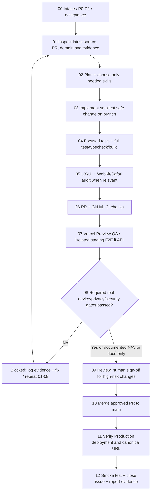

# Money Tracker — Mandatory Project Workflow

> **Source of truth for every change to Money Tracker (เงินวันนี้).** Read together with [../AGENTS.md](../AGENTS.md), [../PRODUCT.md](../PRODUCT.md), [../DESIGN.md](../DESIGN.md), and relevant [AI skills rollout](AI_SKILLS_P0_P2.md).
>
> **Trigger:** Every new task, bug, issue, PR, review, refactor, release, hotfix, or deployment request — *before any edit*. A coding agent that reads `AGENTS.md` must start here. GitHub Actions validates the workflow contract when code is pushed or PRs are opened; it cannot independently perform human tests or make every external agent read files.
>
> **Authority:** The latest user request and financial/data safety take precedence over a stale plan; update this document by reviewed PR when process changes.

## 0. Decide priority and scope (ทุกครั้ง)

| Priority | When | Examples | Release policy |
| --- | --- | --- | --- |
| **P0 Blocker** | Wrong/lost/exposed financial data, security regression, blocked primary slip flow, unsafe false Saved | K PLUS amount/direction/date errors, duplicate totals, broken upload, unauthorized API, Safari critical flow | Stop promotion; root-cause and regression; physical iPhone / isolated staging when relevant |
| **P1 Important** | Daily-use friction, responsive/accessibility fault, safe maintainability or sync QA | UI copy and navigation, 320–430px layout, token-negative tests, Ponytail refactor | Complete code + UX + CI + Preview gates before merge |
| **P2 Improvement** | Non-blocking product or engineering improvement | Graphify-like architecture map, documentation, safe future enhancements | Scoped checks and review; do not displace P0 |

If multiple issues overlap, handle P0 correctness/security before visual polish and P2. **Priority is not the same as phase number in `docs/ROADMAP.md`.**

## Master flow: apply to every task

**Never skip ahead because Vercel says READY or GitHub CI is green.** These checks do not prove real K PLUS image OCR correctness or actual Safari camera behavior. When an external test cannot be done, mark **BLOCKED/UNVERIFIED**, not Passed.

### 00 — Intake and acceptance

- Translate request into one user-observable objective and GitHub issue (or reference an existing one); assign P0/P1/P2, owner, dependencies, constraints and concrete *Definition of Done*.
- Classify scope: **docs-only**, **UI/copy**, **OCR/finance/storage**, **API/auth/sync**, or **release/config**. Record risks, rollback, personal-data exposure and required device/staging gates.
- Avoid duplicate issues/branches and do not silently widen scope. Link overlapping PRs (#63, #66, #72 as applicable at the time — look up current status).

### 01 — Inspect before any change

- Read `AGENTS.md`, `docs/PROJECT_WORKFLOW.md`, `PRODUCT.md`, `DESIGN.md`, relevant `docs/ARCHITECTURE.md`, `docs/OCR.md`, tests, callers and current PR diff.
- Compare default `main`, current branch, active PRs, affected modules, tests, GitHub CI and applicable deployed Preview/Production *separately*. Never infer that PR code is in Production.
- For a bug, reproduce the failing step and identify earliest incorrect boundary with privacy-safe evidence. Log **not yet verified** facts explicitly.

### 02 — Plan + agent skills

- Write expected vs actual, chosen smallest change, affected paths/callers, regression tests, risks and rollback.
- Use **Ponytail reuse-first** (root `AGENTS.md`) for every code task; choose additional repo-local skill only when relevant:
  - OCR defect: `.agents/skills/systematic-debugging/SKILL.md` (Superpowers-inspired).
  - UX/UI, mobile, Safari: `.agents/skills/mobile-ux-qa/SKILL.md`.
  - Auth, API, storage, staging, deployment: `.agents/skills/security-release-review/SKILL.md`.
  - Cross-module changes: `.agents/skills/architecture-impact-map/SKILL.md`.
- Preserve existing library/API/test contracts. No new framework, external agent plugin, secret, migration or graph service without justified review.

### 03 — Implement on an isolated branch

- One coherent issue/fix per feature branch; do not edit `main` directly or overwrite open PR work. Coordinate cross-PR file overlap.
- Keep React + TypeScript + existing CSS tokens, app/local IndexedDB boundaries and optional authenticated iPhone API. Do not fabricate sample financial data in Production.
- Preserve integer **satang**, exact dates/times, direction/owner rules, wallet top-up **expense**, duplicate protection, Pending fallback, rollback and privacy. Never convert ambiguous OCR to automatic Saved.
- Update callers, tests and documentation for *the same* change; redact screenshots and log output.

### 04 — Verification (test)

- Targeted failing regression first for bug fixes; then `pnpm test`, `pnpm run typecheck`, `pnpm build` (build currently also runs tests).
- OCR actual-pixel test: local-only `RUN_PRIVATE_OCR=1 pnpm exec vitest run tests/ocrRealImageGolden.test.ts`, following `docs/OCR_REAL_IMAGE_QA.md`. **CI skip ≠ pass**. Do not upload slips, identities, manifest or OCR transcripts.
- Validate money rules, duplicate/import, Saved vs Pending, failed/retry, backup/restore and safe negative cases for affected scope.
- Docs-only: verify linked paths, Markdown/YAML, no runtime changes, and relevant CI; mark hardware/API checks **not applicable**, not Passed.

### 05 — UX/UI and accessibility audit (when affected)

- Thai-first **Home → Upload Slip → Saved/Pending/Duplicate → Transactions → Reports → Settings**; correct real-data labels and state feedback.
- Respect `DESIGN.md`: 320/375/390/430px, 768/1280px, normal/large reading size, no overflow, iOS safe areas, ≥48px main targets, WCAG/accessibility.
- Use existing UX/UI, Impeccable and Playwright WebKit workflows. Automated WebKit is not real iPhone evidence.

### 06 — GitHub PR and CI

- Open PR with linked issue, P0/P1/P2, scope, before/after, changed files, command results, preview, screenshots (sanitized) and every applicable/blocked gate. Start as draft while unresolved.
- Check **actual latest head SHA** and GitHub Actions jobs: Web App CI, and UX, Impeccable, Safari WebKit when affected. GitHub checks that have not run remain **unverified**, not successful.
- `.github/pull_request_template.md` provides the evidence checklist; `.github/workflows/project-workflow.yml` checks the required files and points reviewers to this procedure automatically. It **does not** replace security/QA validation.

### 07 — Preview QA and isolated staging

- Inspect Vercel Preview for that *exact PR SHA*: UI routing, error messages, no missing assets, intended domain/API environment.
- For API/sync, provision **isolated** test backend + Supabase database and test tokens, run Upload → Pending/Confirm → Sync → Transactions → Reports, duplicate and negative auth/origin cases.
- **Never route Preview into Production Supabase** or expose live money records to obtain a green test. If staging not ready, keep API E2E blocked.
- Check that the preview actually uses the target branch, not an older alias or browser cache.

### 08 — Physical-device and high-risk gates (when applicable)

- For changed OCR/slip handling/UI on iPhone: *physical* iPhone Safari and installed PWA where relevant; K PLUS outgoing, merchant paid amount, incoming/owner, top-up expense, unclear Pending, duplicate, camera/gallery, reload persistence.
- For API/auth/storage: isolated staging E2E, rejection of invalid token/origin, no cross-owner records, no secrets/PII in logs or client bundle.
- Review count and totals against known private expected results without publishing bank images. Record anonymized IDs, pass/fail and device/browser build.
- **Failure or missing evidence blocks Production** for financial or affected-device changes. Do not waive because other tests pass.

### 09 — Review and release decision

- Review UX, tests, data/security implications, CI results and actual Preview/physical device evidence.
- Human approval/sign-off is required for P0 financial changes and any Production financial/API release. Resolve review comments; close all required gates or keep PR draft/blocked.
- **Docs-only exception:** no physical-slip/staging gate if no running behavior changed; verify diff and required CI, review, then merge. Do not claim runtime features are released.

### 10 — Merge

- Merge to `main` only after relevant checks and approvals; no forced merge, auto-merge or manual alias shortcuts around failed gates.
- Verify PR head has not moved, and linked issue/PR statuses accurately reflect what was merged.

### 11 — Production deployment

- Confirm Vercel project/branch connection to `main` and the **configured canonical Production Domain**; use an actual Vercel record, never assume that a branch-specific Preview URL is the stable link.
- Check Production deployment status and active build SHA (do not equate CI success with deployment). Do not claim production updated before verification.
- For a docs-only merge, Vercel may redeploy due to Git; this is **not** proof of a feature release.

### 12 — Production smoke test + report

- Verify actual canonical URL, app startup, navigation, upload entry point, main flow, saved/pending/duplicate as applicable, sync/health when configured, and persisted data.
- If smoke test fails, stop rollout and follow approved safe rollback path (do not wipe live finance data).
- Post exact links to issue, PR, commit SHA, GitHub runs, Preview, Production version, safe QA outcomes, unresolved blockers and next action. Close issue only once acceptance is satisfied.

## Gate matrix (minimum; add case-specific tests)

| Change | Targeted tests + typecheck/build | UX/WebKit | Physical iPhone | Isolated staging API | Review/CI |
| --- | --- | --- | --- | --- | --- |
| Docs/agent guidance only | Path/format + applicable CI | N/A | N/A | N/A | Required |
| Visual/copy | Tests when behavior changes | Required | Required for affected Safari/mobile release | N/A unless sync | Required |
| Browser OCR/finance/storage | Required + private image test for OCR | If user flow touched | Required for actual K PLUS/mobile flow | Only if remote flow touched | Required |
| API/auth/sync | Required with negative tests | If UI touched | Required when iPhone integrated flow affected | **Required** | Required |
| Deploy/config | Verify build/status SHA | Regression for changed UI | If changed mobile behavior | If backend settings changed | Required |

## Every-task report contract

At start: `Priority | Issue | Branch / latest SHA | Affected flow | Selected skills | Acceptance + risk`.

At end: `Status: DONE / BLOCKED / UNVERIFIED | changed paths | tests (actual results) | PR/CI | Preview | iPhone/staging evidence or N/A | main/Production SHA and domain if verified | remaining risk / next step`.

**Meaning of "every time":** GitHub PR/push checks run automatically by configured Actions. This Markdown process runs at the start of *every task for any coding agent that follows root `AGENTS.md`*. Neither Markdown nor CI can autonomously run physical iPhone verification or force external ChatGPT sessions/tools to consult the repository; explicitly load repository instructions in other environments.
