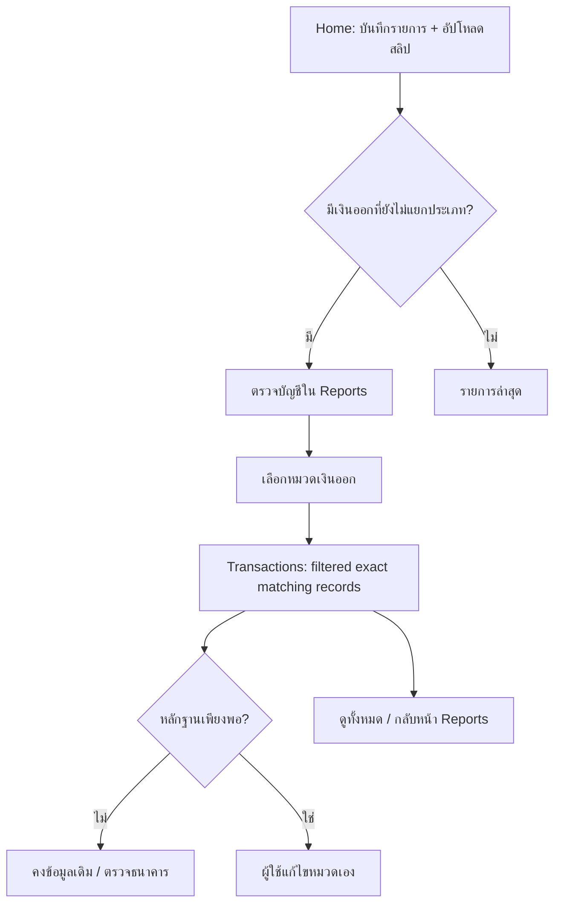

# Money Tracker — UX Revamp: ตรวจบัญชีแบบทำงานต่อได้

## Goal / role
**User:** คนที่อัปโหลดสลิป K PLUS เป็นประจำ ไม่ใช่นักบัญชีเต็มเวลา แต่ต้องการมองเงินเข้า–เงินออกอย่างรอบคอบ

**Priority:** P1 usability improvement with P0 guardrails for financial semantics. Builds on PR #79; no financial mutations, no new external service/schema, no auto-confirmation of pending rows.

## Before → After

| Screen | Previously | Revamp (in this PR) |
|---|---|---|
| Home | Total, upload, recent, generic alerts | Same simple Home hierarchy + contextual entry **รายการยังไม่แยกประเภท** (only when selected-month rows exist) leading to accountant summary |
| Reports → ภาพรวม | Monetary metrics, non-interactive accountant breakdown among charts | Focused overview (money metrics + guided audit only); charts and budget move to their own existing tabs; four exclusive satang-conserving groups; one-tap report → filtered transactions; task-oriented warnings |
| Transactions | All/income/expense search and manual correction | Filter banner **กำลังดู: ...** from report bucket, exact underlying bucket helper, explicit **ดูทั้งหมด** reset; existing edit/undo/delete confirmations unchanged |
| Pending | Separate local-slip/iPhone queues | No silent reconciliation. From the report use existing queue review actions; monthly saved rows and all-month pending counts are labeled distinctly |
| Reports terminology | "รายจ่าย" sometimes implied consumption spending | "เงินออกที่บันทึก" and accurate category, budget, monthly-net labels; still not bank balance or audited P&L |

## User journey / design acceptance

- No auto classifier is permitted to turn a transfer to a person into consumption.
- **Transaction audit buckets** come from a single `accountantBucketFor()` shared by totals and transaction drill-down. Every saved expense in the selected month belongs to exactly one bucket; all bucket totals are integer satang and sum to money-out.
- "Wallet top-up = expense" remains current product policy. Accountant warning must mention possible double counting.
- Debt repayments can include principal, interest and fees; not equated to audited expense.
- Pending is not included in monthly totals. iPhone Pending count can be unknown until connected; local/iPhone counts span months.
- Matching name+time+amount is a **candidate**, not proof of duplicate. Existing manual deletion confirmation unchanged.
- Home entry remains conditional on local saved records. Cloud changes pending #78 require their own sync/reconciliation release.
- CSV export remains all months, visibly labeled.

## Test matrix

| Gate | Conditions |
|---|---|
| Unit | Correct bucket per record and matching filtered rows; income excluded, wallet top-ups remain expense, integer satang |
| Automated Chromium UX | 320/375/390/430/768/1280, accessibility scan, no horizontal scroll, save/review workflows unchanged |
| WebKit automated | 320/375/390/430, account breakdown subtotals and labels, tap unknown bucket → one filtered row → clear → all five fixture entries → return to Reports |
| Preview manual | Same PR SHA as Preview, empty vs populated month, search/filter, screen readers, keyboard / large font, local data only |
| Physical iPhone | Safari/PWA, real tap targets, normal/large fonts, safe areas, real K PLUS Photos camera/gallery path unchanged, pending and storage reload |
| Finance release | Physical device evidence + review/sign-off; no real bank data in Preview or CI, no Production merge until all gates pass |

## UX principles

1. One prominent `อัปโหลดสลิป` action on Home; never force accounting questions during capture.
2. Plain Thai and truthful claims. "เงินออก" is **cash movement**, not certified consumption.
3. An alert must lead to the next useful place. Four audit buckets are now clickable with recoverable filters.
4. Avoid arbitrary dashboard decoration. White space, accessible green, clear signed values, 48px targets.
5. Preserve original IndexedDB transaction data, totals, privacy and backup/restore semantics.

## Rollback / dependencies

- Revert this PR (or only the UX commits) to remove the read-only UI and filter while leaving finance data untouched.
- PR #78 adds Gmail subtype syncing; PR #77 adds a read-only Home secretary. These are separate and **not assumed deployed**; resolve any overlapping files during review.
- If Preview cannot be authenticated safely for cloud sync, classify the cloud part as **BLOCKED**, not PASS. Isolated staging required for API E2E.
